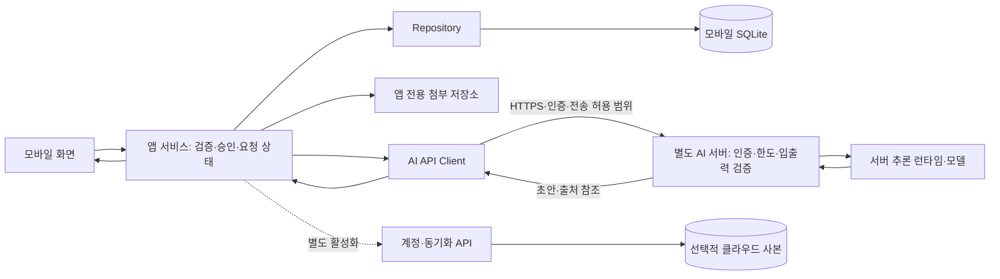

# 전체 구조와 책임

## 실행 위치

모바일이 모델 파일을 설치하거나 LLM 추론을 실행하는 기본 경로는 두지 않습니다. AI 서버와 동기화 서버는 논리 책임을 분리합니다. 반드시 물리 서버 두 대를 구축한다는 뜻은 아닙니다.

## 책임 분리

| 계층 | 책임 |
| --- | --- |
| 화면 | 입력·결과 표시·로딩/오류·전송 확인·초안 승인 |
| 앱 서비스 | 입력·날짜 검증, 요청 취소·최신성 확인, 결과 검토·승인 |
| Repository | SQLite 조회·수정·트랜잭션·revision 확인 |
| AI API Client / Provider | 서버 요청·응답 변환·인증 전달·타임아웃 처리 |
| AI 서버 API | 호출자 인증·인가, 입력 크기·요청 한도, 모델 호출, 결과 형식 검증 |
| 서버 모델 런타임 | 자연어 해석·정리·업무 후보·근거 답변 생성 |
| 계정·동기화 | 사용자·기기·변경 버전·충돌·선택적 클라우드 사본 |

화면에서 직접 DB나 모델을 호출하지 않습니다. 모델에 SQL 실행·모바일 DB 직접 접근·임의 도구 실행 권한을 주지 않습니다. 데이터 저장 권한과 사용자 승인 책임은 모바일 서비스에 유지합니다.

## AI 경로 변경

| 항목 | 이전 설계 | 현재 결정 |
| --- | --- | --- |
| 기본 추론 | 기기 내 LLM 우선 | 별도 AI 서버 |
| 모델 관리 | 앱에서 설치·로딩·메모리 관리 | 서버에서 배포·로딩·자원 관리 |
| 호출 조건 | 로컬 한계 이후 외부 보완 | 매 AI 요청 전 유효한 전송 허용·인증 확인 |
| 네트워크 없음 | 로컬 모델 가용성에 따라 AI 가능 | AI 사용 불가, 수동 기록 유지 |
| 모바일 설정 | 로컬 모델 관리 중심 | AI 사용·전송 범위·서버 연결 상태 중심 |
| 측정 | 모바일 추론 RAM·발열·속도 | 서버 추론 자원·동시성·비용, 모바일 왕복 지연 |

OCR/STT·임베딩 등은 별도 과업입니다. 이번 결정으로 전부 서버 처리나 이미 구현된 것으로 간주하지 않습니다. 첫 AI 경로는 확인된 텍스트를 대상으로 합니다.

## 구축 시 확정할 항목

서버 프레임워크·호스팅·모델/라이선스·런타임·GPU/RAM·동시 처리 수·인증 방식·서버 보관 정책·운영 비용을 정합니다. 기존 계정 서비스를 이용할 경우 서버가 토큰 유효성과 사용자 범위를 검증해야 합니다. 실제 공급자 키·관리자 키·모델 서버 내부 주소를 앱에 포함하지 않습니다.

AI 서버를 통해 제3자 AI API를 사용할지는 별도 결정입니다. 자동 재전송·다른 공급자 전환으로 허용된 처리 범위를 넓히지 않습니다.
