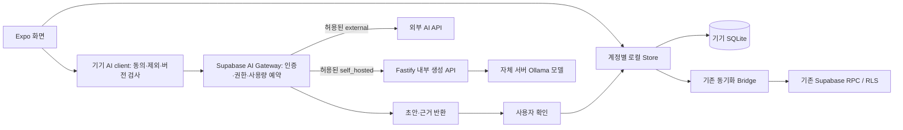

# 코드 통합 현황과 재현 절차

작성일: 2026-11-16. 기준 main: `e7397a5a79ce202af19a5af5ff67bb2b977f10f8`.
작업 브랜치: `codex/integration-cloud-contracts`. 이 문서는 배포 완료 보고서가 아니다.

## 적용 구조



기기 SQLite와 클라우드 추론을 사용한다. 분산 추론과 온디바이스 LLM은 구현하지 않는다. 기기 client가 먼저 전송을 제한하고 Gateway는 그 범위에서 서버 권한과 동의를 다시 검사한다. 현재 라우팅은 사용자가 허용한 명시적 경로이며 토큰 수에 따른 자동 최적화는 추가하지 않았다. 자체 서버 실패 시 외부 API로 자동 전환하지 않는다.

기존 Supabase URL 경로·요청 DTO·사용량 RPC 시그니처는 유지했다. 확장은 `x-ai-route: external|self_hosted`, 별도 `SERVER_AI` 동의, 배포 설정의 자체 서버 주소이다. 헤더가 없는 기존 요청은 기존 external 경로를 유지한다. 최신 앱 client는 기본 전송 금지 상태에서 시작한다. 응답의 usage 토큰 값은 불명일 때 `null`을 반환하도록 타입을 수정했다. 이 nullable 응답과 신규 동의를 포함한 기존 앱 호환성은 V02의 실제 시험이 필요하다.

## 이번 코드 연결 범위

| 영역 | 반영 내용 | 확인 한계 |
|---|---|---|
| 인증 | 프론트 가짜 계정/OTP를 기존 Supabase 인증 모듈로 교체 | 실제 메일·OAuth 미실행 |
| 기기 저장소 | 계정별 SQLite 파일, 기존 local Store·sync Bridge, UI Store 어댑터 | 실기기 재시작·두 계정 전환 미실행 |
| 기본 기록 | 메모/할 일/일정 CRUD와 기존 제안 승인 경로 연결 | 기기 UI 상호작용 미실행 |
| 동기화 | 기존 Supabase transport·워크스페이스·즐겨찾기 연결 | 실제 DB/RLS/권한 철회 미실행 |
| 문서 AI | 저장된 메모 분석→요약/추출 제안, 질문 계획→기기 검색→근거 답변 연결 | 합성 응답 시험. 실제 모델 품질 미측정 |
| 전송 통제 | 명시적 동의, 제외 자료, 경로 제한, 호출 전 재검사, 원본 revision·계정·공간·취소 검사 | 파생 경로 전체 유출 시험 미실행 |
| 자체 모델 | Gateway→Fastify `/internal/generate`→고정 Ollama 주소·모델, 별도 서비스 자격 증명 | 실제 모델 로딩·RAM·지연 미측정 |
| AI 모듈 | AI 작업 브랜치 c8ddc0b의 src/test/package를 `ai/`로 포함 | 현재 화면 실행 경로는 기존 Gateway DTO를 사용. 이 라이브러리의 모든 파이프라인이 화면에 노출되는 것은 아님 |

`src/data/`는 원래 화면이 참조하지만 저장소에 없던 모듈을 기존 백엔드에 연결하는 어댑터다. 계정 데이터의 정본은 local Store이며 화면 전용 설정은 계정별 SQLite의 `integration_preferences`에 둔다. 동기화 DB도 계정별 파일로 분리한다. 로컬 DB 암호화·OS 백업 차단은 이번에 구현하지 않았다.

## 아직 통합 완료로 볼 수 없는 영역

- 프로젝트·안건 비교·백업/복원·구독·보안 설정·탈퇴는 서버/로컬 기능을 끝까지 연결하지 않았다. 해당 화면 진입은 준비 중 안내로 막고 어댑터의 미구현 변경 요청은 성공으로 반환하지 않는다. 이것은 기능 완료나 해당 Gate 면제를 뜻하지 않는다.
- 파일 보관함은 기기 복사/메타데이터 경로만 연결했다. 공유 사진 업로드 어댑터, 서버 첨부 복원, 문서 추출·장시간 녹음, 다른 기기 복원은 미완료다. 공유 첨부가 필요한 시연은 V22 통과 전 불가하다.
- 알림은 기기 알림과 서버 푸시의 중복 제거·시간대 시험이 남았다. 설정의 사용량 표시는 기기 표시값이며 과금/구독의 정본이 아니다. 프로필 저장은 기존 서버 API에 연결했지만 실제 계정에서 실행하지 않았다. 손글씨의 기존 외부 직접 호출은 Gateway 정책을 우회하므로 비활성화했다.
- Gateway 사용량 예약/정산은 기존 DB 계약을 재사용한다. 이번 시험은 실제 PostgreSQL RPC의 원자성, 비용 정확성, 동의 철회 경쟁 조건을 증명하지 않는다.
- 개별 요청 원장에는 unknown 토큰/비용을 null로 전달한다. 기존 집계 view에는 `coalesce(sum(...), 0)`가 남아 있으므로 운영 비용 평가에 그 합계만 사용하면 안 된다. 미측정 요청 수를 함께 내보내는 집계 계약 보완은 V26의 후속 조건이다. 앱 요청 취소는 결과 반영을 막지만 이미 시작한 원격 추론 중단·과금 취소를 보장하지 않는다.
- 실제 Android 앱 설치, 네이티브 SQLite 저장/재시작, iOS 실행, 서버 배포, 모델 품질/성능, 삭제·복구·부하 시험은 하지 않았다. Android export 성공은 설치/실행 성공이 아니다.

## 실행 준비

1. `frontend/Frontend_UI`에서 `npm ci`. `.env`에 `EXPO_PUBLIC_SUPABASE_URL`, `EXPO_PUBLIC_SUPABASE_KEY`를 대상 테스트 프로젝트 값으로 지정한다. 기존 config 기본 주소가 있으므로 실행 전 반드시 대상을 확인한다. secret/service_role 키를 앱 환경 변수에 넣지 않는다.
2. Supabase 테스트 프로젝트에서 기존 migration 전체와 `20261116090000_self_hosted_consent.sql`을 순서대로 재생하고 기존 RPC 테스트를 실행한다. 새 migration은 실제 DB에 적용하지 않았다. 함수 정의가 예상과 다르면 의도적으로 중단한다. 운영 DB에 바로 적용하지 않는다.
3. 이메일 인증 템플릿/redirect를 기존 클라우드 문서에 맞춰 설정한다. OAuth 앱 scheme은 `ai-assistant-planner`, callback은 `auth/callback`이다. 실제 `makeRedirectUri` 결과를 확인하여 Supabase allowlist에 등록한다. Expo Go와 개발 빌드의 URI는 다를 수 있다.
4. `backend/cloud`에서 `npm ci`, 환경 설정 후 `npm start`. 자체 호스트에 `AI_GATEWAY_SECRET`(최소 32자), `OLLAMA_BASE_URL`, `OLLAMA_MODEL`을 지정한다. Gateway 전용 실행은 기존 `AI_AUTH_TOKENS`를 비워 둘 수 있다. Ollama 모델은 별도 설치가 필요하며 모델 이름·라이선스·토큰 적합성·필요 메모리는 아직 확정하지 않았다.
5. Gateway 서버 secret에 `SELF_HOSTED_URL`(원격은 HTTPS origin), `SELF_HOSTED_SECRET`(호스트와 동일), `SELF_HOSTED_MODEL`(호스트와 동일)을 지정한다. 외부 API를 시험할 때만 기존 외부 provider 설정을 별도로 사용한다. 브라우저/앱에 서비스 secret을 배포하지 않는다.
6. 호스트 제한값은 `MAX_CONCURRENT`, `MODEL_TIMEOUT_MS`, `INTERNAL_MAX_INPUT_CHARS`, `MODEL_CONTEXT_TOKENS`, `MODEL_OUTPUT_TOKENS`. 기본 입력 8,000자는 토큰 적합성 보장이 아니다. 긴 문서는 거절하며 자동 청킹/축약은 하지 않는다. 자체 호스트 동시성은 기존 공개 API와 공유하며 초과 시 거절한다. 다중 replica 전역 한도·큐는 별도 운영 설계가 필요하다.
7. 앱 `npm start` 후 별도 개발 빌드/실기기에서 확인한다. AI 설정에서 선택한 서버 전송에 명시적으로 동의해야 요청할 수 있다. 요약은 원본 메모를 자동 수정하지 않고 승인 대기 제안으로 저장한다.

외부 전송을 수반하는 단계 2~7은 이 작업에서 실행하지 않았다. Supabase 프로젝트 설정, 실제 모델, 테스트 계정과 기기가 갖춰져야 다음 수용 시험을 진행할 수 있다.

## 로컬 재현 검사

저장소 루트에서:

```powershell
npm run test:integration
npm run test:local
npm run test:cloud
npm run test:ai
npm exec --yes --package=deno -- deno check --node-modules-dir=none backend/supabase/functions/ai-gateway/index.ts
npm exec --yes --package=deno -- deno test --node-modules-dir=none --import-map=backend/supabase/tests/import-map.json --allow-read --allow-env --allow-net=127.0.0.1,localhost --allow-sys --no-check backend/supabase/tests/provider_routing.test.ts
```

local 테스트가 참조하는 엔진 검증 의존성은 `tests/sync-verify`에서 `npm ci`가 필요하다. Deno HTTP 시험은 loopback 서버를 열며 실제 모델/외부 AI를 호출하지 않는다. 각 패키지의 의존성 설치가 선행되어야 한다.

Android 번들 검사는 `frontend/Frontend_UI`에서:

```powershell
$env:EXPO_OFFLINE = '1'
npx expo export --platform android --output-dir .integration-build/android
```

검사 결과와 미실행 Gate는 [평가 계획 v2](validation/PLAN-v2.md), [수용 시험 기록표](validation/cases-v2.csv), [실행 증거](validation/EXECUTION-2026-11-16.md)에 구분한다. 기능 브랜치의 변경이며 원격 main 병합·배포는 수행하지 않았다.
