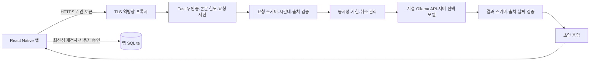

# AI 서버 상세 설계

작성일: 2026-11-09. 현재 구현: Node.js + Fastify HTTP API / Ollama 어댑터. 실행법은 [서버 README](../backend/cloud/README.md)에 있습니다.

## 구조

서버는 DB 연결·원문 저장·외부 작업 실행을 하지 않습니다. 범용 챗봇/도구 호출 엔드포인트도 제공하지 않습니다. 인증된 사용자가 제출한 텍스트만 처리합니다. 다른 사용자의 서버 기록을 조회하는 기능 자체가 없습니다. 로컬 DB 권한·AI 제외/삭제 상태는 앱이 발췌 전 확인해야 하며 서버는 이를 독립 확인할 수 없습니다.

## 모듈

| 파일 | 책임 |
| --- | --- |
| backend/cloud/src/index.js | 설정 읽기, 시작·종료 |
| backend/cloud/src/config.js | 환경 설정 검증, 토큰 레코드 |
| backend/cloud/src/app.js | 라우팅·인증·요청 제한·동시성·취소·기한·안전한 오류 |
| backend/cloud/src/contracts.js | 요청/결과 JSON Schema와 날짜·근거 의미 검증 |
| backend/cloud/src/ollama.js | Ollama 요청 생성·응답 크기 제한·오류 변환 |
| backend/cloud/scripts/create-token.js | 소규모 팀 시험용 개인 토큰 발급 |

## API 계약

모든 AI API는 POST JSON과 Bearer 인증을 요구합니다. 요청의 추가 필드·문자열로 전달한 숫자·잘못된 타입은 거절합니다. 서버 모델명·URL·SQL·실행할 도구는 클라이언트 입력으로 받지 않습니다.

공통 필수 필드:

| 필드 | 제한 |
| --- | --- |
| clientRequestId | 영숫자/밑줄/하이픈 1~80자. 모바일 결과 대조용 |
| inputRevision | 0 이상 JavaScript 안전 정수 |
| consent | true만 허용. 앱에서 현재 범위 전송 허용을 확인한 뒤 지정 |
| timeZone | 유효한 IANA 시간대, 최대 80자 |
| referenceTime | 오프셋 또는 Z가 있는 ISO 일시. 모바일이 기준 시각을 제공 |

| 경로 | 추가 요청 필드 | result |
| --- | --- | --- |
| /v1/ai/organize | text: 최대 8,000 UTF-16 단위 | summary, candidates |
| /v1/ai/conditions | question: 최대 1,000 UTF-16 단위 | keywords: 최대 8개, recordType: all/note/task/event |
| /v1/ai/answer | question, evidence: 최대 3개 | answer, insufficientEvidence, citations |

근거는 `{id, revision, text}`이며 text는 각 1,200 UTF-16 단위 이하입니다. 중복 ID를 거절합니다. conditions의 결과로 앱이 허용된 로컬 조회를 수행하고, 재검사한 발췌만 answer에 보냅니다. 조건 해석 첫 버전은 키워드·기록 유형만 지원하며 날짜 범위·정렬·자연어 조건 전부를 구현하지 않았습니다.

후보는 `{kind, title, dueDate, sourceQuote}`입니다. kind는 task/event, dueDate는 유효한 YYYY-MM-DD 또는 null, sourceQuote는 원문의 정확한 일부여야 합니다. 시간 단위 일정·반복·자동 저장은 지원하지 않습니다.

인용은 `{id, revision, quote}`입니다. 제공한 근거 ID·revision·정확한 발췌만 허용합니다. 근거 없음은 모델을 호출하지 않고 부족 응답을 반환합니다. 일반 답변은 인용이 최소 하나 필요하고 부족 응답은 인용을 비웁니다. 이 검증은 인용의 존재를 검사하며 답변의 의미적 정확성·프롬프트 주입 완전 방어를 보장하지 않습니다.

성공 응답은 `{requestId, clientRequestId, inputRevision, task, result}`입니다. requestId는 서버가 새로 발급합니다. 앱은 자체 입력 revision·취소 여부를 다시 확인하고 사용자 승인 후 저장해야 합니다. 서버는 현재 앱 revision을 알 수 없으므로 오래된 결과 반영을 대신 차단하지 않습니다.

오류는 `{requestId, error: {code}}`입니다.

| 상태 | code 예 |
| --- | --- |
| 400 | INVALID_REQUEST, INVALID_TIME_ZONE, INVALID_REFERENCE_TIME, INPUT_TOO_LONG, DUPLICATE_EVIDENCE |
| 401 | UNAUTHORIZED |
| 413 / 415 | PAYLOAD_TOO_LARGE / UNSUPPORTED_MEDIA_TYPE |
| 429 | RATE_LIMITED, SERVER_BUSY. Retry-After 제공 |
| 502 | MODEL_UNAVAILABLE, INVALID_MODEL_OUTPUT |
| 504 | MODEL_TIMEOUT |
| 500 | INTERNAL_ERROR. 내부 오류 본문은 반환하지 않음 |

## 한도·실패 처리

- 본문 최대 49,152바이트, 서버 모델 응답 최대 131,072바이트.
- 기본 사용자당 분당 10요청, 사용자당 진행 중 추론 1개, 전체 2개.
- 모델 기한 기본 30초. 연결 중단/기한 도달 시 HTTP 추론 요청을 abort하고 처리 슬롯을 해제.
- Ollama 요청 중단이 GPU 작업의 즉시 종료·자원 회수를 보장하지는 않으므로 대상 런타임에서 측정 필요.
- 큐·자동 재시도·결과 캐시·서버 DB 없음. 과부하는 대기열 없이 거절.
- clientRequestId는 추적용이며 완료된 호출의 멱등 키가 아님. 재호출은 다시 추론하므로 앱의 자동 반복 전송을 금지하고 명시적 재시도로 제한.
- 모델 반환 JSON도 신뢰하지 않고 스키마·실제 출처·날짜를 재검사. 모델 형식 실패 시 자동 보정/재호출 없이 오류 반환.
- 모델명은 서버 환경 설정에서만 선택. 온도 0, 출력 상한 2,048 토큰, 문맥 8,192를 초기 제한으로 사용하며 모델별 적합성·지연 측정 후 조정.

## 인증·배포 경계

현재는 사용자별 256비트 무작위 토큰의 SHA-256과 만료 시각만 설정합니다. 최대 100개 레코드로 한정하며, 같은 사용자로 발급된 토큰은 요청 한도를 공유합니다. 계정 로그인·JWT·refresh·공유 제한 저장소는 후속입니다. 공개 앱에 공통 비밀 토큰을 넣지 않습니다.

단일 API 프로세스와 내부 Ollama가 최소 구성입니다. Node API에는 GPU가 필요하지 않고 실제 모델 런타임 자원은 별도로 확보합니다. Docker/모델 버전은 배포 전에 업데이트·라이선스·호스트 호환성을 점검하고 모델을 직접 설치해야 합니다. TLS 프록시·GPU 설정·운영 배포는 이번 코드의 검증 완료 범위가 아닙니다.

## 참고

- [Fastify 스키마 검증](https://fastify.dev/docs/latest/Reference/Validation-and-Serialization/)
- [Ollama chat API](https://docs.ollama.com/api/chat)
- [Next.js API 역할](https://nextjs.org/docs/app/guides/backend-for-frontend): 웹 UI가 없는 현재 범위에서는 Fastify를 선택.
